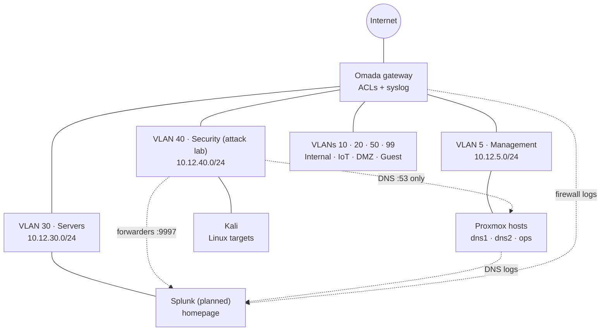

# Enterprise Homelab

A homelab built as a **small enterprise SOC environment**: segmented networks, Splunk as the SIEM, Linux attack targets, and an isolated attack VLAN. It exists to practice and demonstrate security operations: emulate an attack, detect it, investigate it, write it up.

**The case work lives in [soc-casework](https://github.com/J-DeMarzo/soc-casework).** This repo is the environment those cases run in, including the Splunk config and the detections they link to ([ADR 0011](docs/adr/0011-soc-casework-own-repo.md)).

> **Status:** infrastructure and documentation are in place. Lab isolation, Splunk and the Linux attack targets are built, and the first case write-ups are under way in soc-casework.

| Evidence | Where |
|---|---|
| Investigations (case write-ups) | [soc-casework](https://github.com/J-DeMarzo/soc-casework) |
| SPL detections, each tested against an emulated attack | [`detections/`](detections/) |
| Lab isolation rules, with before/after test results | [`docs/architecture/firewall-rules.md`](docs/architecture/firewall-rules.md) |
| SIEM design and config as code | [`docs/architecture/siem.md`](docs/architecture/siem.md) · [`splunk/`](splunk/) |
| Design decisions | [`docs/adr/`](docs/adr/) |

## Architecture



| | |
|---|---|
| **Hypervisor** | Proxmox VE: 3-node cluster (`TheRising`) + standalone storage node (`Sefi`), 32 threads / ~100 GiB RAM |
| **Network** | TP-Link Omada gateway. 7 VLANs (management, internal, IoT, servers, security lab, DMZ, guest) with a default-deny ACL policy |
| **SIEM** | Splunk Enterprise: Universal Forwarders, Sysmon, DNS and firewall logs, a homemade alert queue on Splunk Free ([ADR 0006](docs/adr/0006-soc-focus-with-splunk.md)) |
| **Targets** | Linux hosts and a deliberately vulnerable web app on the isolated lab VLAN, with Universal Forwarders (a Windows target is deferred). An Active Directory estate was built and retired 2026-10-14 ([`ad-lab-v1`](https://github.com/J-DeMarzo/enterprise-homelab/tree/ad-lab-v1)) |
| **Core services** | Redundant Technitium DNS (`demarzo.lab`) split across failure domains |

Detail: [overview](docs/architecture/overview.md) · [network](docs/architecture/network.md) · [firewall rules](docs/architecture/firewall-rules.md) · [compute](docs/architecture/compute.md) · [storage](docs/architecture/storage.md) · [DNS](docs/architecture/dns.md) · [live inventory](docs/inventory.md)

## Skills demonstrated

- **Security operations:** alert triage, investigation, incident documentation, MITRE ATT&CK mapping
- **Splunk:** data onboarding (forwarders, sourcetypes, indexes), SPL detections, dashboards, summary-index alerting
- **Endpoint telemetry:** Sysmon, Windows Security events, Linux journald
- **Network security:** VLAN segmentation, firewall ACL design, and verification testing
- **Infrastructure:** Proxmox clustering, templates, cloud-init, redundant DNS, docs as code

## Roadmap

| Phase | Focus | Status |
|---|---|---|
| 0 | Documentation foundation | ✅ Done |
| 1 | Hygiene: guest metadata, tags, admin host in the management zone | ✅ Done |
| 2 | Safe to attack: default-deny between VLANs, [tested](docs/architecture/firewall-rules.md#test-results) | ✅ Done |
| 3 | Visibility: Splunk plus log sources, [license budget measured](docs/architecture/siem.md#license-budget) | ✅ Done |
| 4 | Targets: Linux hosts and a vulnerable web app (network/Linux focus, no AD, Windows deferred) | ✅ Done: `linux-victim` and `vuln-web` with auditd + forwarders, scripted rebuild. Windows target deferred |
| 5 | SOC workflow evidence: emulate → detect → investigate → write up | ➡️ Moved to [soc-casework](https://github.com/J-DeMarzo/soc-casework/blob/main/roadmap.md) |

Full detail: [docs/roadmap.md](docs/roadmap.md)

## Repository layout

```
docs/
  architecture/    how the lab is built, incl. firewall rules
  adr/             why it is built that way
  runbooks/        operational procedures
  incidents/       incident reports from running the lab
  inventory.md     generated from the Proxmox API
  roadmap.md
detections/        SPL detections
splunk/            Splunk config as code (indexes, zone lookup, forwarder inputs)
scripts/           inventory generator
```

## Security note

This repo is public. It contains private RFC 1918 addresses and the internal lab domain, which aren't reachable from outside. It contains no credentials, API tokens, keys, or public IPs. Commits are scanned with [gitleaks](https://github.com/gitleaks/gitleaks). All attack activity is confined to an isolated lab VLAN against systems I own.
